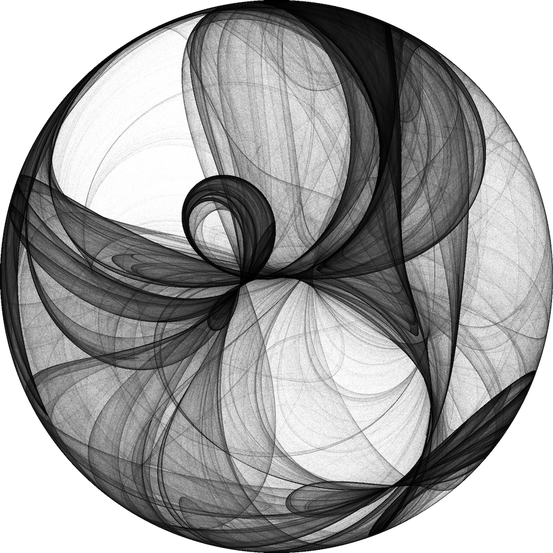
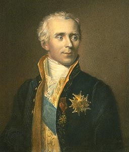
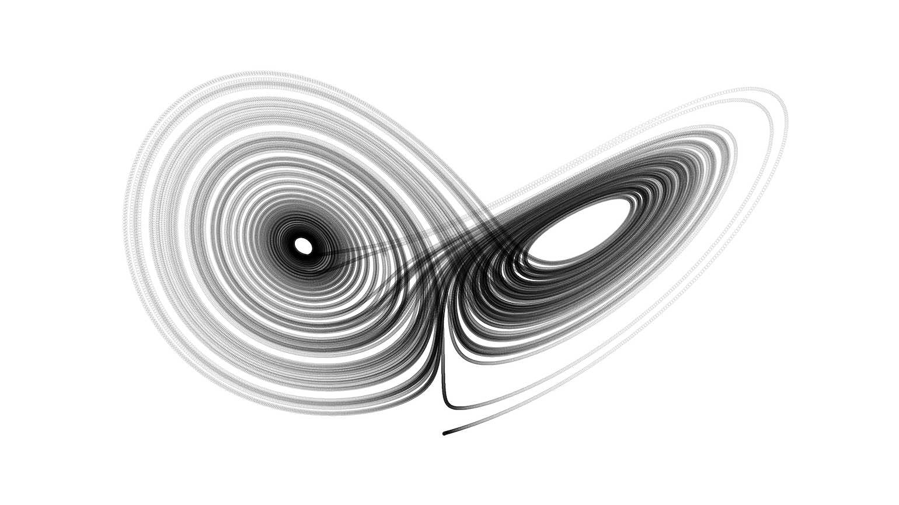
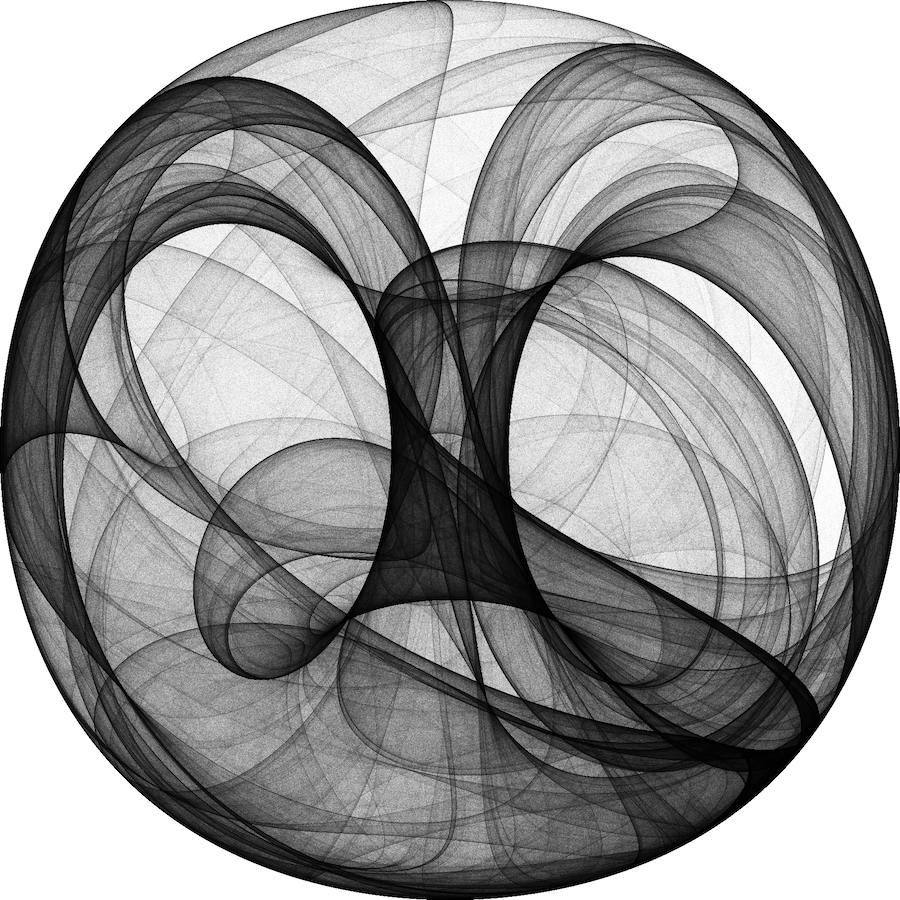
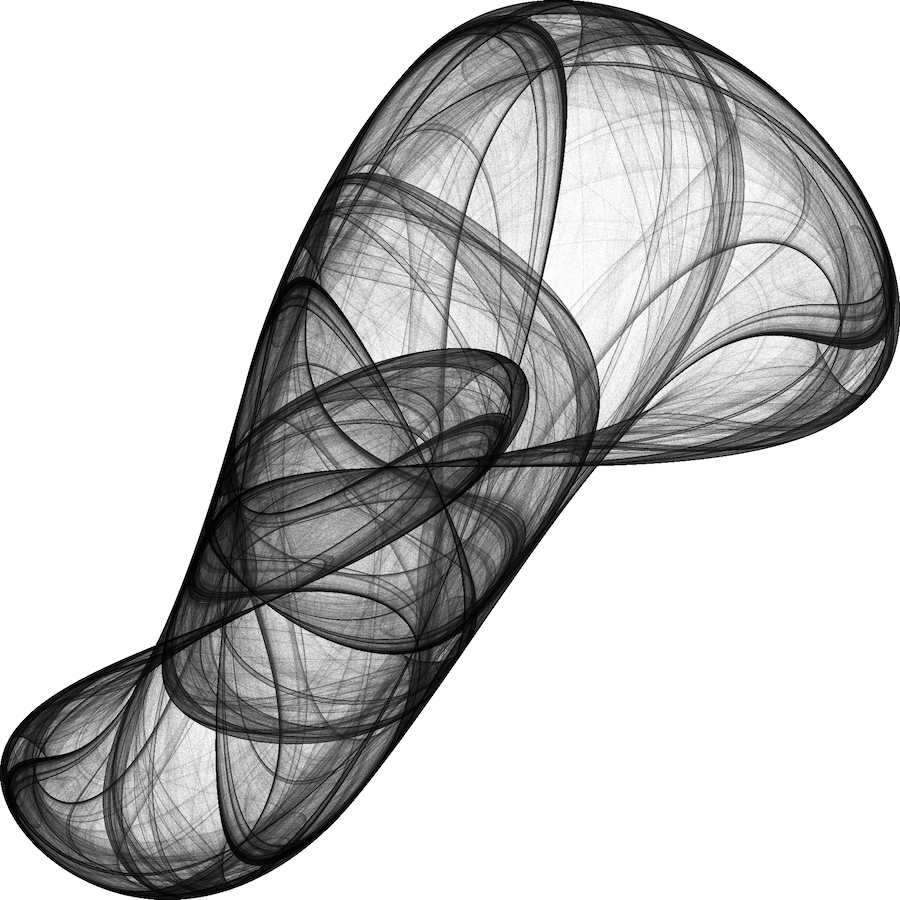

:::figure{width="45%"}

Strange attractor goes wow.
:::

In the early XIXe century, in its seminal essay *Essai philosophique sur les probabilités*, French mathematician Pierre-Simon de Laplace laid the foundation of probabilities as the theory for capturing the universe's dynamics conditioned on our own inability to observe all of its machinery.

He envisioned that an intellect, that could at any moment know all the physical properties of every component of the universe, and all forces that apply to them, could predict perfectly both the future and past evolution of the universe. Recognising the inaccessibility of such knowledge in practice, he thereupon suggested to use probabilities to generate informed guesses on the occurence of future effects. This strongly ties his intuition to hard determinism, or linear causality; $$\forall e \,,\exists C\,, e = f(C)$$, with $$e$$ an effect and $$C$$ a set of causes.

:::figure

Our boi Laplace
:::

This vision is very intuitive to me. As a human, my intellect (quite under-developed compared to the one described above) allows me to capture the mechanics between some causes and effects. If, for example, I press a light switch, I can guess pretty accurately what its future position will be. In other cases, the causes are unobservable, or too multiple for me, making any prediction on the effect unsurmontable; typically, I cannot predict the outcome of throwing a die.

This makes the definition of probability theory very empowering, and motivated me to study it in my Masters degree. With probabilies, we can seemingly overcome our causal blindness and learn directly about the world from the observed effects. In the case of the previous example, the assumption of a balanced die instruct us that the outcomes of a throw are equiprobable. This in turns allows us to infer properties about the effects that we might observe. We know for example that obtaining 5 times the same outcome in a row is very unlikely.

This hope for understanding the occurence of effects, despite our complete knowledge of causes is nevertheless hindered by chaotic dynamical systems.

:::meta
. . .
:::

Strange attractors are dynamical systems that exhibit a set of states towards which the system converges that exhibits a fractal structure. Because most of them rely on chaotic dynamics, they display fascinating properties. Two points, no matter how arbitrarily close they originally are, will become arbitrarily far apart after enough iterations. Counter-intuitively, a global macroscopic structure that confines the attractor will also emerge from these same dynamics.

:::figure{width="50%"}

Lorenz Attractor
:::

Lorenz's attractor, whose shape coincidentely illustrates the notion of butterfly effect, is the best known strange attractor. Its dynamics are described by the system of differential equations:

$$
\begin{align}
    \frac{dx}{dt} &= \sigma\,(y - x)\,,\\
    \frac{dy}{dt} &= x\,(\rho - z) - y\,,\\
    \frac{dz}{dt} &= xy - \beta z\,.
\end{align}
$$

Amongst my personal favourites are De Jong and Clifford's attractors. Their dynamics are captured by a remarkably simple set of equations, and yet, they result in intricate fractal patterns contained in æsthetic attractors.

**Clifford's attractor**

$$
\begin{aligned}
\frac{dx}{dt} &= x + \sin(\alpha y) + \gamma\,\cos(\alpha x)\\
\frac{dy}{dt} &= y + \sin(\beta x) + \delta\,\cos(\beta x)
\end{aligned}
$$

:::figure{width="50%"}

Clifford attractor
:::

**De Jong's attractor**

$$
\begin{aligned}
\frac{dx}{dt} &= x + \sin(\alpha y) - \cos(\beta x)\\
\frac{dy}{dt} &= y + \sin(\gamma x) - \cos(\delta x)
\end{aligned}
$$

:::figure{width="50%"}

De Jong attractor
:::

Back to determinism and probabilities. What do strange attractors have to say about determinism?
As described by Ilya Prigogine and Isabelle Stengers in their essay *Entre le temps et l'éternité*, these systems blur, or make disappear altogether, the causal link between causes and effects. Indeed, the notion of cause and effect presupposes the ability to define trajectories.

State trajectories define the evolution of any element of the universe, and as such, constitue the record of effects that applied on it. But in the case of these strange attractors the notion of trajectory becomes meaningless. Any infinitely small variation in the definition of the element whose trajectory is investigated results in entirely different outcomes. As a result, the existence of edge-case systems for which the reduction of a continuous spectrum of possibles into definite, discrete elements with fixed properties results in a disappearing of our ability to define their trajectory of evolution and consequently seriously challenges the hard determinism of Laplace.

One might counter-argue that determinism might still aplly on the ideal, continuous dynamics of the system, and therefore survives unaffected this hurdle. I would question the legitimacy of such an argument as it relies on a description whose very sense supposes a fundamentally unreachable state of knowledge; physical objects indeed have a typical dimension, and are thus by nature not continuous$$^1$$.

This insight forced me to revisit my understanding of probabilities. Instead of being a theory for overcoming our inability to capture the complete state of the universe, **I now rather see it as a theory that captures the macroscopic structures that emerge from the continuous variations of the possibles**. Don't ask me why, but I find this new paradigm reassuring and empowering.

If you came here purely for the nice visuals, I also recommend visiting [Paul Bourke](http://paulbourke.net/fractals/clifford/), [Vedran Sekara](https://vedransekara.github.io/2016/11/14/strange_attractors.html), [PyViz](https://examples.pyviz.org/attractors/attractors.html), and [Ben](https://blbadger.github.io/clifford-attractor.html)'s posts.

I gathered all the code in a [GitHub repository](https://github.com/pierresegonne/funky-attractors), feel free to have a look.

Thanks for reading!

:::meta
1: My current understanding is that any physical object without a typical size must be a singularity in the continuum of space-time, but this is clearly not my area of expertise, and might be mistaken. Let me know if you disagree.
:::
