:::figure
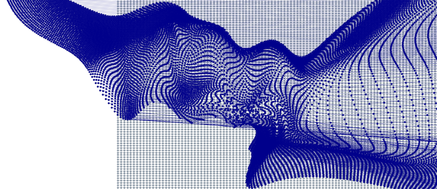

Deformation of space induce by a normalizing flow.
:::

_All code related to this post is accessible on [Github](https://github.com/pierresegonne/VINF)_

## The Posterior Distribution

Probability theory is key to quantify uncertainty in any phenomenon and is therefore essential to the development of thinking machines. Specifically, probabilistic models describe how the interactions between observed variables $$x$$, latent (in the sense of unobserved) variables $$z$$ and parameters $$\theta$$ can generate useful information about target variables. In most cases, the knowledge of the posterior distribution $$p(z, \theta\lvert x)$$ is crucial. For example it allows to compute the marginal likelihood of a new observation $$x’$$.

$$
\begin{aligned}
p(x'\lvert x) &= \int p(x', z, \theta \lvert x)dzd\theta\\
&= \int p(x' \lvert z, \theta)p(z, \theta \lvert x)dzd\theta\, .
\end{aligned}
$$

The posterior distribution appears in the computation of the marginal likelihood of a new observation

By Bayes Theorem,

$$
p(z, \theta\lvert x) = \frac{p(x\lvert z, \theta)p(z, \theta)}{p(x)}\, .
$$

It can be seen that the posterior distribution $$p(z, \theta \lvert x)$$ depends on the evidence $$p(x)$$ which is generally unknown in closed form and takes exponential time to compute. This implies that the posterior distribution is too, in the general case, impossible to know exactly with a closed form solution.

## Variational Inference

It is nevertheless possible to use optimisation techniques to determine the most adequate approximate posterior distribution $$q^*$$ from a given family of probability distributions $$Q$$, defined on the latent space of $$z$$. The Kullback-Leibler (KL) divergence provides an effective measure of closeness of two probability densities and can hence be used to determine $$q^*$$.

$$
q^* = \text{arg}\min_{q\in Q}\text{KL}(q\lvert\lvert p(\cdot \lvert x))\, .
$$

Unfortunately, it is generally not possible to directly use the KL divergence to determine the optimal variational approximation. Instead can be used the evidence lower bound function (ELBO) defined as

$$
\text{ELBO}(q) = -\mathbb{E}[\log q] + \mathbb{E}[\log p(\cdot, x)]\, .
$$

Maximising the ELBO function is equivalent to minimising the KL divergence, thus resulting in an adequate variational approximation. Using well documented optimisation techniques such as stochastic gradient descent while estimating the expected values involved in the definition of the ELBO with Monte-Carlo integration provides an efficient, versatile and scalable method to determine an approximation of the true posterior distribution.

It nevertheless has one massive drawback, the quality of the approximation is limited by the flexibility of the variational family $$Q$$, as shown by the following example.

:::figure
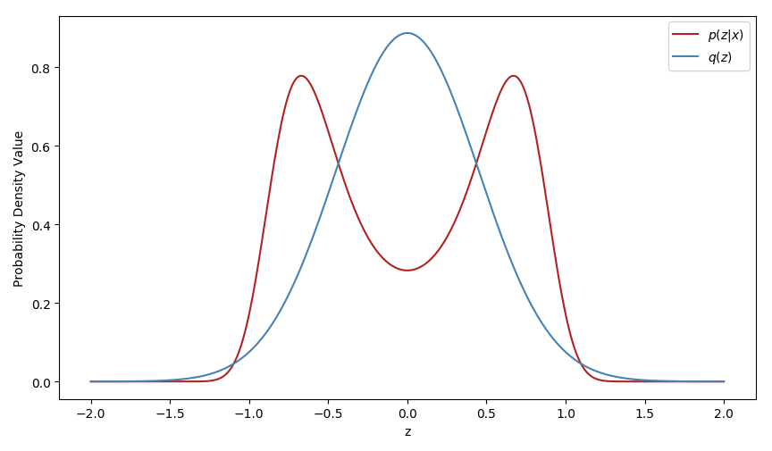

Variational approximation obtained when restricting the family to Gaussian distributions.
:::

The variational family Q was there restricted to Gaussian distributions and cannot thus capture the multimodality of the true posterior.

:::meta
. . .
:::

## Normalizing Flows

To rectify this limitation it is nevertheless possible to transform initially simple distributions, such as the Gaussian, into arbitrarly complex approximate posterior distributions. Normalizing flows consists in a chain of invertible mappings that can be applied to transform an initial probability distribution into a vastly different probability distribution.

Let’s consider an initial random variable $$z$$ with its associated distribution $$q$$. Applying an invertible mapping $$f$$, with inverse $$g$$ onto it results in a new random variable $$z’ = f(z)$$ with associated distribution $$q’$$ that is expressed as

$$
q'(z') = q(z)\Bigm\lvert \text{det}\frac{\partial g}{\partial z'}\Bigm\lvert = q(z) \Bigm\lvert \text{det}\frac{\partial f}{\partial z}\Bigm\lvert^{-1}\, .
$$

To give an intuition into the effect of a flow, let’s consider the exponential function. It is smooth and invertible, with $$f=\exp$$ and $$g=\log$$, and thus it makes it easy to display the effect of the flow on both the space of the random variable and on the associated probability distribution. Below, the red curve represents the original distribution, defined on the space spanned by the red crosses. In blue is represented the resulting distribution after the flow, which can be expressed as

$$
q'(z') = q(g(z'))\Bigm\lvert\frac{dg}{dz'}\Bigm\lvert = \mathcal{N}(\log z'\lvert 0,1)\Bigm\lvert\frac{1}{z'}\Bigm\lvert \, .
$$

And the blue crosses are the respective images of the red crosses through the flow.

:::figure
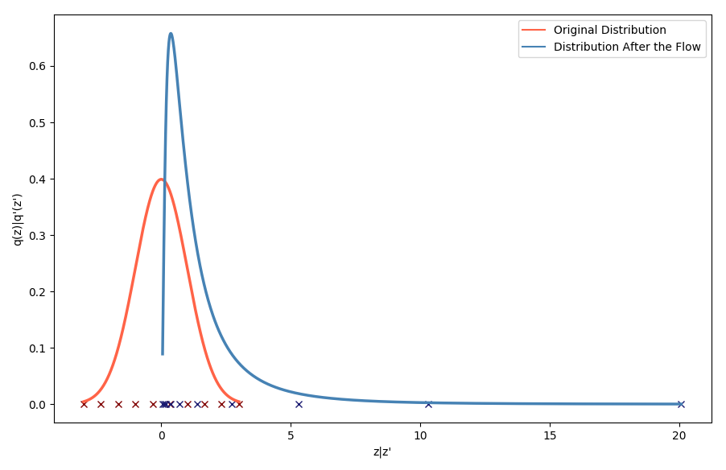

Effect of an exponential flow on an original Gaussian distribution.
:::

The resulting distribution is logically a log-normal distribution. By warping the space on which lies the considered random variable, the resulting probability distribution is affected. Here the warping consists of taking the negative half-line of the real axis and compacting it on the right side of 0, while dilating the positive half-line of the real axis. As a result, the density of the resulting random variables would greatly increase on the right side of zero, where space as been compacted, and gradually decrease when moving away from 0. Theoretically, this warping of space can then become arbitrarily more complex as the flow considered also gains in depth, or complexity. Indeed, the invertible mappings, or flows, can be chained. For $$f_1$$, $$f_2$$, …, $$f_k$$ invertible smooth mappings, $$z_k$$, the random variable resulting of the application of the chain of flows, and its associated probability density $$q_k$$ verify

$$
\begin{aligned}
    z_k &= f_k \circ \dots \circ f_1(z_0)\\
    q_k(z_k) &= q_0(z_0)\prod_{i=1}^{k}\Bigm\lvert\text{det}\frac{\partial f_i}{\partial z_{i-1}}\Bigm\lvert^{-1}\, .
\end{aligned}
$$

The warping effect of more complex flows can be observed on the following plots, which displays the respective images (blue dots) through a deep flow (16 layers) of an initial meshgrid (grey).

:::figure
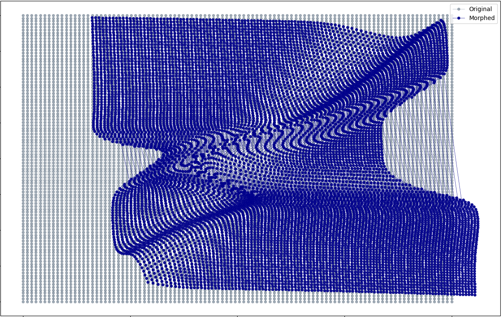 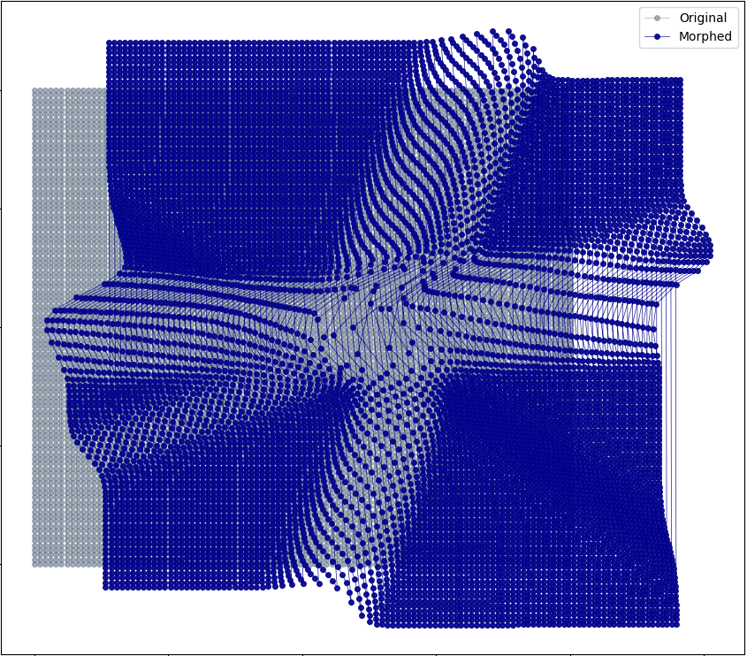

Effect of a normalizing flow on a 2 dimensional meshgrid.
:::

In their seminal paper [[1]](https://arxiv.org/pdf/1505.05770.pdf) D. Rezende and S. Mohamed introduced two types of flow which offer interesting shaping properties while having a Jacobian-determinant easy enough to compute efficiently (namely O(LD) where L is the number of layers in the flow and D the dimension of the Jacobian)

### Planar Flow

First, in the case of the planar flows, the invertible mappings, parametrised by $$u$$, $$w$$ and $$b$$ are expressed as follows

$$
\begin{align}
f(z) &= z + uh(w^Tz+b)\\
\log q_k(z_k) &= \log q_0(z_0) - \sum_{i=1}^{k} \log (\lvert 1 + u_i^T \psi_i (z_{i-1})\lvert)\, .
\end{align}
$$

Such flows induce contractions and expansions along hyperplanes. The two following plots show the effect of the Jacobian-determinant for both effects.

:::figure
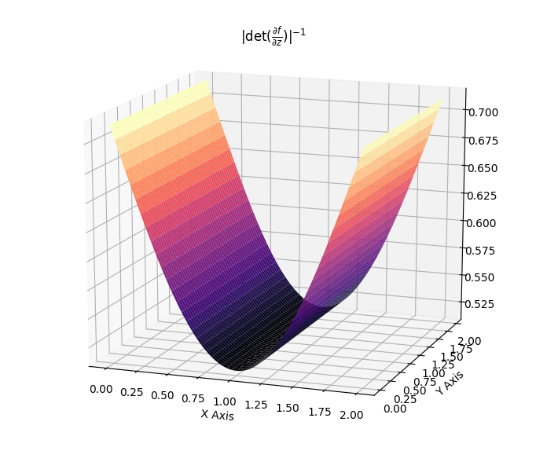 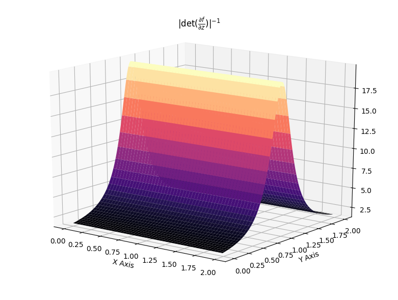

Contraction (left) and expansion (right) along an hyperplane as induced by a planar flow.
:::

Which then results in transformation of distributions as showcased below, where a standard Gaussian distribution is first contracted along an hyperplane and then expanded away from its mode.

:::figure
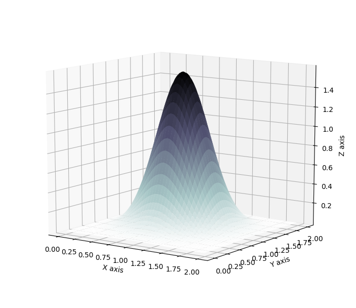 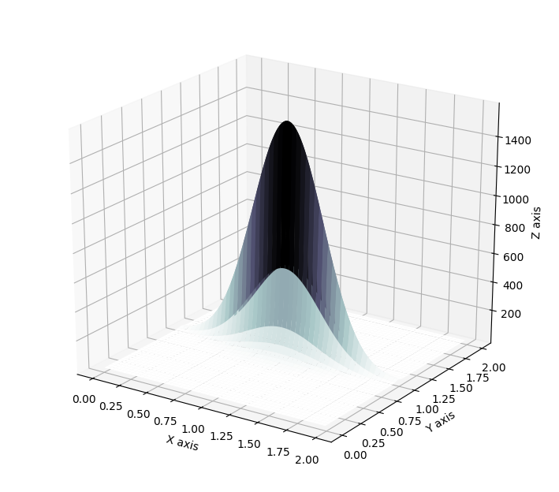 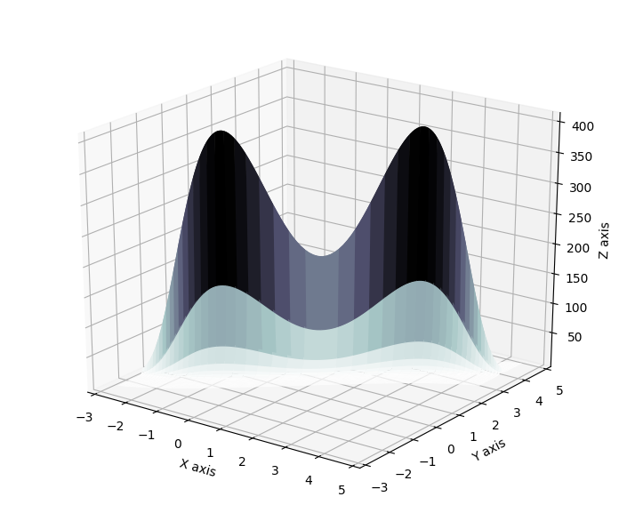

Successive deformation of an original Gaussian distribution by planar flows.
:::

### Radial Flow

Then, in the case of the radial flows, the mapping and resulting transformation are described, for the parameters $$\alpha$$, $$\beta$$, $$z_r$$ and for r the distance between the reference point $$z_r$$ and any other point $$z$$, as

$$
\begin{align}
f(z) &= z + \beta h(\alpha, r)(z-z_r)\\
\log q_k(z_k) &= \log q_0(z_0) - \sum_{i=1}^{k}\left[(D-1)\log (1+ \beta h(\alpha , r))\log (1 + \beta h(\alpha,r) + \beta h'(\alpha , r)r)\right]\\
h(\alpha , r) &= \frac{1}{\alpha + r}\, .
\end{align}
$$

Such flows induce contractions towards and away from the chosen reference point. Again, the effect of the Jacobian-determinant is displayed with the following.

:::figure
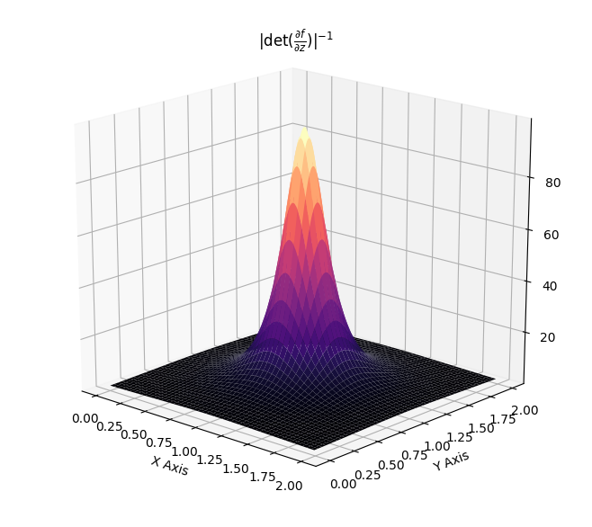 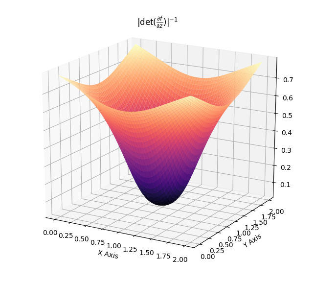

Contraction (left) and expansion (right) towards a reference point as induced by a planar flow.
:::

The following showcases the transformation induced by a radial flow, which first focuses an original gaussian towards a given reference point and then expands it away from a neighbouring other reference point.

:::figure
 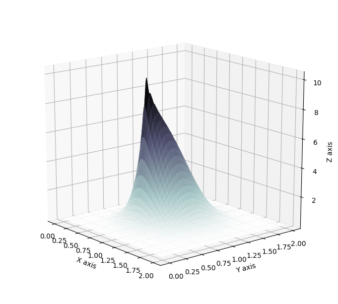 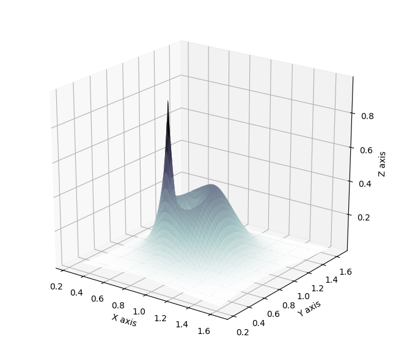

Successive deformation of an original Gaussian distribution by radial flows.
:::

Other types of flows have been developed. For more details about the concepts involving normalizing flows, I would recommend reading the original article [[1]](https://arxiv.org/pdf/1505.05770.pdf). Several blog posts also provide insightful considerations; A. Kosiorek in [Normalizing Flows](http://akosiorek.github.io/ml/2018/04/03/norm_flows.html) focuses with great clarity on theoretical details, E. Jang in [Normalizing Flows Tutorial](https://blog.evjang.com/2018/01/nf1.html) provides easily understandable theoretical descriptions and links it with a useful introduction to actual implementation through the use of bijectors from tensorflow probability, L. Rinder et al’s code accessible in their [GitHub repository](https://github.com/LukasRinder/normalizing-flows) gives a good starting point to implement your own normalizing flows. Finally, I would recommend anyone to read my [own report](https://pierresegonne.github.io/VINF/), which expands more in depth in the mathematical details behind such technique.

:::meta
. . .
:::

Using normalizing flows as a way to make any variational family $$Q$$ more flexible is a powerful tool, once implemented, it can be applied to any variational inference problem to improve the performance of the approximation. For example, its use on the simple 1D demonstration example which showed how the choice of the variational family could restrict the performance of a model results in a much better approximation, as shown below, where in red is the true posterior and in blue the variational approximation (the difference in scale is the result of neglecting the evidence).

:::figure
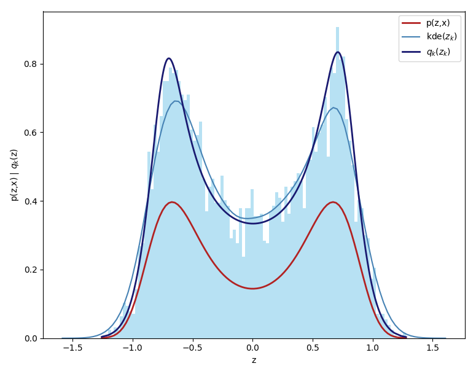

The application of flows on an original unimodal distributions allows capturing multimodal distributions.
:::

Using the same demonstrative energy functions as in the seminal paper, it is possible to demonstrate that starting from an original gaussian distribution, with the application of normalizing flows, can result in variational approximation that display symmetrical, periodic and in general non trivial properties. For reference, the true posterior distributions (called here energy functions) are displayed below.

:::figure
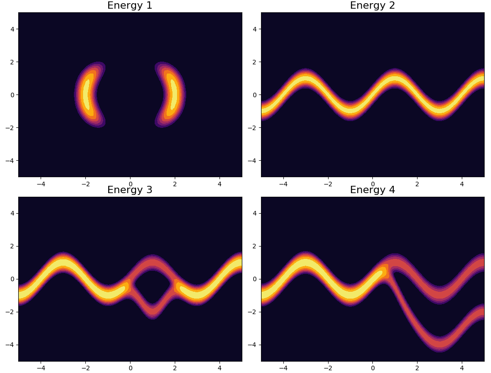

Densities for different test energy functions.
:::

And below are the variational approximation obtained with my implementation, with the use of planar flows.

:::figure
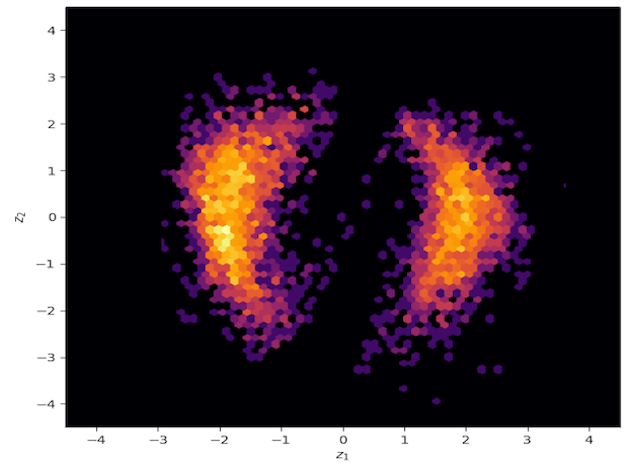 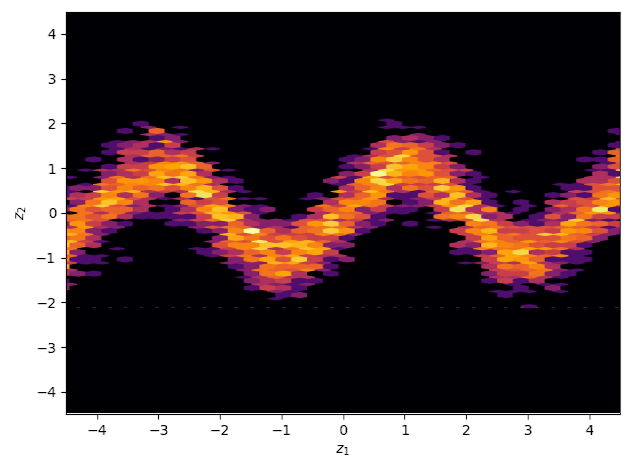

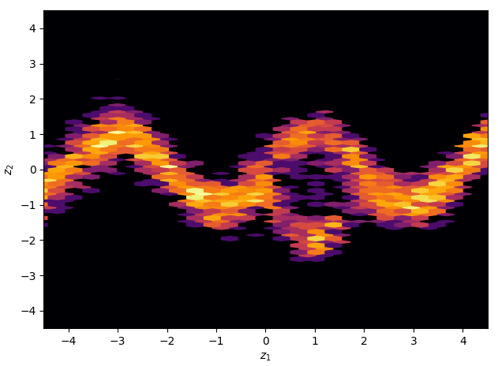 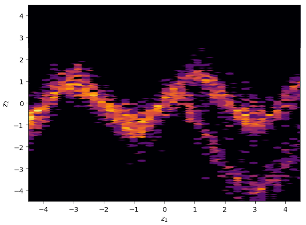

Approximated densities after the application of flows.
:::

## The Eight School Model

In the conclusion of the seminal paper, D. Rezende and S. Mohamed write

> Normalizing flows allow us to control the complexity of the posterior at run-time by simply increasing the flow length of the sequence

This is a bold statement, implying that normalizing flows can always, given a sufficient flow length, results in an adequate variational approximation. This statement was put to the test on a simple hierarchical model called the eight school model, as introduced by A. Gelman et al in [[2]](http://www.stat.columbia.edu/~gelman/book/). It can be described with the following graphical model, where the respective $$y$$ are the average effects of a given treatment in each school, $$\sigma$$ the observed standard deviation for the effect in each school, $$\theta$$ the latent true effect of the treatment in each school and $$\mu$$ and $$\tau$$ the parameters describing the true underlying effect of treatment in general.

:::figure{width="50%"}
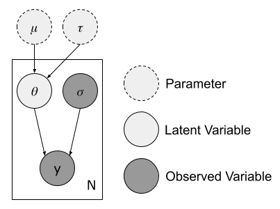

Probabilistic graphical model for the eight school model.
:::

The true posterior distribution is

$$
\begin{align}
p(\theta, \mu, \tau \lvert y, \sigma) &\propto p(y, \theta, \sigma, \mu, \tau)\\
&= \prod_{i=1}^{8}\mathcal{N}(y_i\lvert\theta_i,\sigma_i)\prod_{i=1}^{8}\mathcal{N}(\theta_i\lvert\mu,\tau)\mathcal{N}(\mu\lvert0,5)\text{Half-Cauchy}(\tau\lvert 0,5)\, .
\end{align}
$$

The problem space has 10 dimensions ($$\theta$$ for each school, $$\theta$$ and $$\mu$$). To study the fit of the variational approximation, visualisations will be restricted to $$\theta$$ and $$\tau$$ for the first school. As displayed below, the posterior has an interesting shape, with a strong neck that has been shown in practice to be difficult for any kind of approximate posterior distribution to fit perfectly.

:::figure
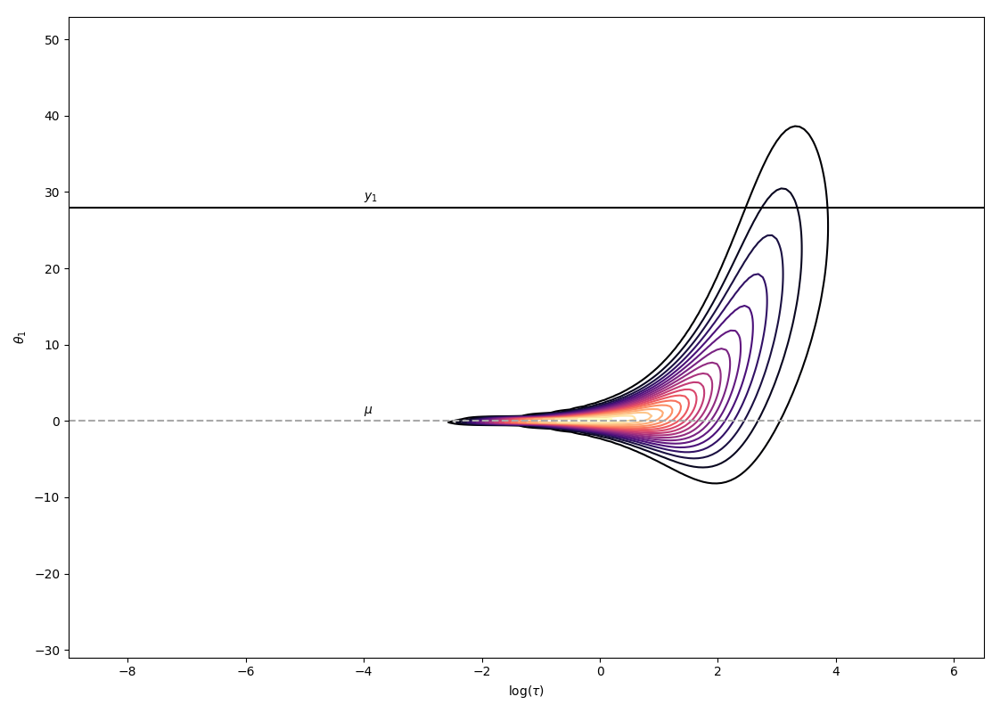

True posterior p(𝜃,log(𝜏)) for the first school in case of 𝜇 = 0.
:::

The resulting approximation with planar flows and a flow depth of 32 results in the following approximation. It is clearly not satisfactory as it does not explore at all the neck of the true posterior distribution (in blue are MCMC samples for reference, please look into my full report for more details).

:::figure
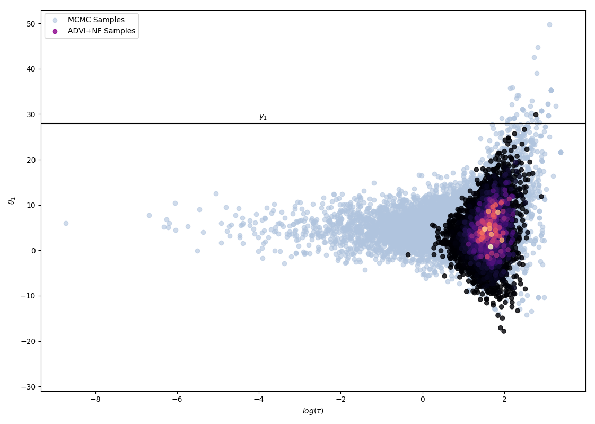

Posterior approximated with MCMC.
:::

To study whether we can hope to achieve a better fit with a greater depth of flow, as hinted by D. Rezende and S. Mohamed, an experiment was ran, using a simplified model, considering only the first two schools (hence reducing the dimensionality of the problem), recording performance with varying flow depth.

The following 4 figures display the evolution of the obtained variational approximation with increasing depth of flow. From top left to bottom right, the flow lengths are, 10, 20, 40, 80.

:::figure
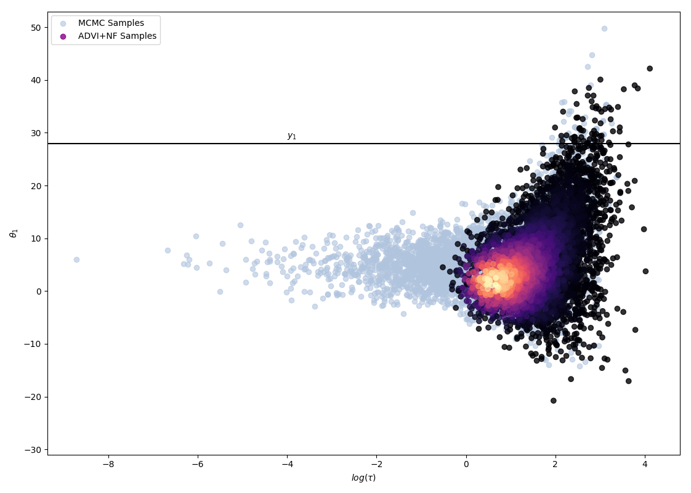 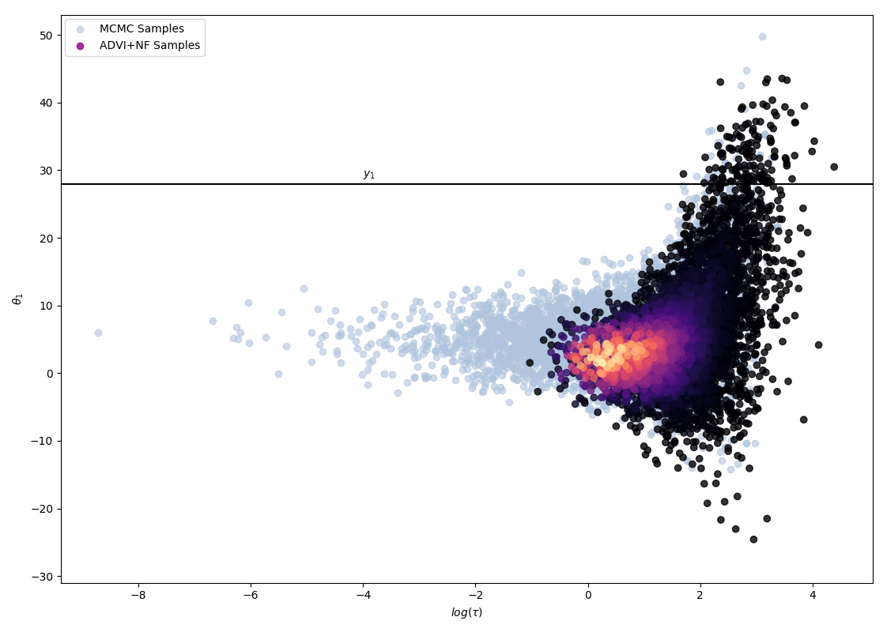

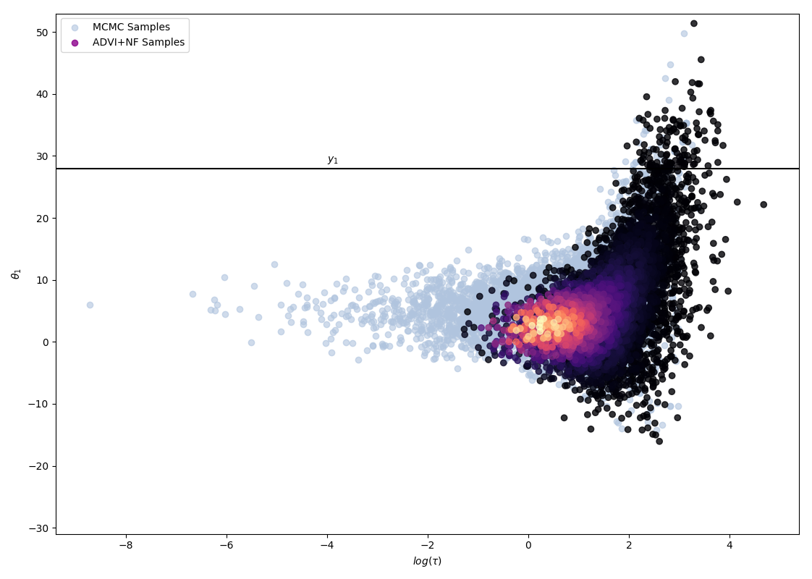 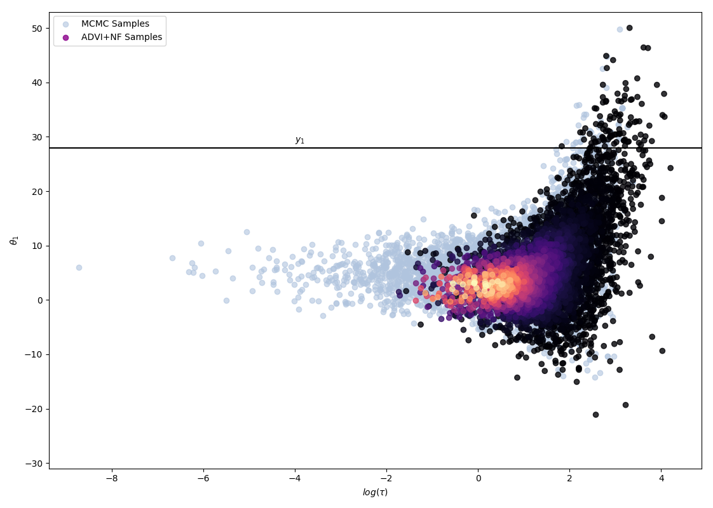

Approximated posterior after the application of flows (10, 20, 40, 80 layers of flows respectively).
:::

There is a quite clear improvement of the fit of the approximate posterior and a better exploration of the neck of the true posterior with deeper flows, but the result, even with a chain of 80 invertible mappings as flow, does not seem to be a perfect fit of the true posterior. To quantify more precisely the fit of the approximate posterior based on the flow length, were recorded two diagnostics. The value of the ELBO (right on figure below) must be maximised to train the approximation, and therefore, a greater achieved ELBO should result in a better fit. The $$\hat{k}$$ diagnostic (See A. Vehtari et al [[3]](https://arxiv.org/pdf/1507.02646.pdf) for reference), is also a good indicator for an appropriate variational approximation is displayed on the right below.

:::figure
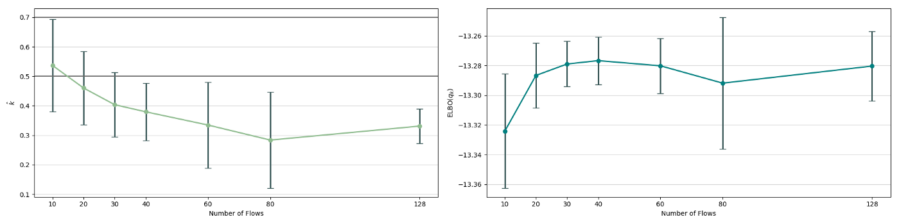

k̂ diagnostic for different flows depth.
:::

The measured diagnostics (over 5 training runs and for each trained model, 5 sets of generated samples) indicate that up to a depth of 80, the deepening of the flow leads to an increased fitting ability. It nevertheless shows that this effect as a limit, as for a depth of 128 layers, the increase in performance becomes unclear. A possible explanation for this phenomenon is the vanishing gradient problem; the deeper the flow is, the more difficult it becomes to propagate gradients throughout and to train the model efficiently.

## Conclusion

This study detailed how normalizing flows, which are constituted by a succession of invertible mappings, can transform probability distributions, Gaussian typically, into new distributions, with highly complex features. Normalizing flows, employed together with an automatic and differentiated approach to variational inference, relying on Monte Carlo gradient estimation for the optimisation of the ELBO function, provides an efficient, scalable and versatile way to approximate arbitrarily complex posterior distribution of probabilistic models.

Furthermore, the eight-school model was used to first show that in the case of a significantly more complex model, with a higher dimensional latent space and hierarchical dependencies, the normalizing flows indeed provide a significant improvement in the variational approximation. It also revealed that the performance of the flows is limited by the number of layers in the flow. Theoretically, the deeper the flow is, the richer posterior approximation it should generate, but it was seen that in practice, deepening the flow only has a beneficial impact up to a certain depth.

Normalizing flows are nevertheless a very promising method, which if used with better suited mappings, such as in Inverse Autoregressive Flows [[4]](https://proceedings.neurips.cc/paper/2016/file/ddeebdeefdb7e7e7a697e1c3e3d8ef54-Paper.pdf) or in Masked Autoregressive Flows [[5]](https://proceedings.neurips.cc/paper/2017/file/6c1da886822c67822bcf3679d04369fa-Paper.pdf), can result in practical techniques with state of the art performance, as was achieved with the Parallel WaveNet [[6]](http://proceedings.mlr.press/v80/oord18a/oord18a.pdf) model which is currently used by Google Assistant to generate realistic speech.

## References

* [1] D. J. Rezende, and S. Mohamed, “Variational inference with normalizing flows,” arXiv preprint arXiv:1505.05770, 2015
* [2] A. Gelman, J. B. Carlin, H. S. Stern, D. B. Dunson, A. Vehtari, and D. B. Rubin, Bayesian data analysis. CRC press, 2013.
* [3] A. Vehtari, D. Simpson, A. Gelman, Y. Yao, and J. Gabry, “Pareto smoothed importance sampling,” arXiv preprint arXiv:1507.02646, 2015.
* [4] D. P. Kingma, T. Salimans, R. Jozefowicz, X. Chen, I. Sutskever, and M. Welling, “Improved variational inference with inverse autoregressive flow,” in Advances in neural information processing systems, pp. 4743–4751, 2016.
* [5] G. Papamakarios, T. Pavlakou, and I. Murray, “Masked autoregressive flow for density estimation,” in Advances in Neural Information Processing Systems, pp. 2338–2347, 2017.
* [6] A. v. d. Oord, Y. Li, I. Babuschkin, K. Simonyan, O. Vinyals, K. Kavukcuoglu, G. v. d. Driessche, E. Lockhart, L. C. Cobo, F. Stimberg, et al., “Parallel wavenet: Fast high-fidelity speech synthesis,” arXiv preprint arXiv:1711.10433, 2017.
