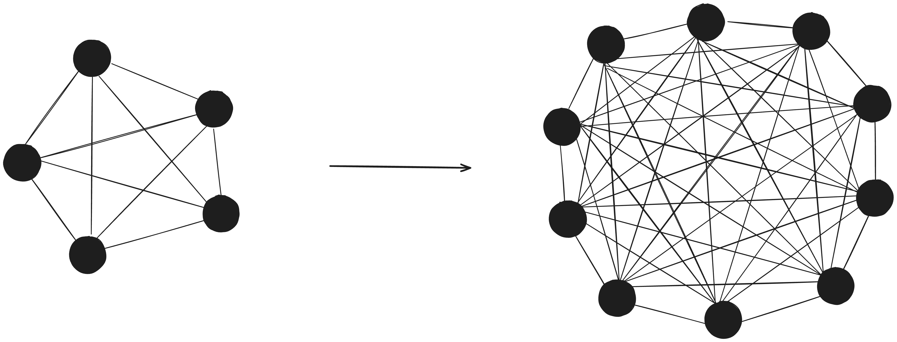
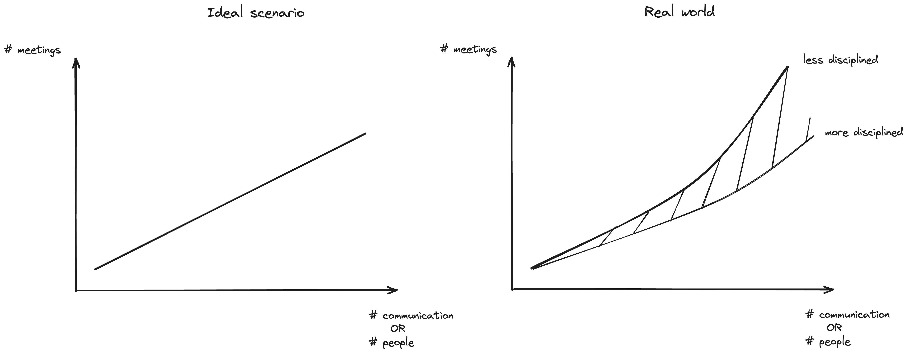

**Saying "no" is scary**. It's scary when you have to say no to friends that want to go for an extra round of drinks the night before taking an early train. It's also scary when you have to decline a meeting organised by cheerful colleagues who are excited to demonstrate the progress they've accomplished.

Saying no is scarier when you have to be the first one to do it within a social group. Not wanting to stand out and being ostracised is a deeply engrained instinct. **Yet, it's necessary to say no; refusing meetings and ignoring communication channels is necessary to be able to focus on what is critically important for us.**

## Why do I have so many meetings?

I am experiencing this first hand through my work at [Electricity Maps](https://www.electricitymaps.com/). In 2020, I joined a small and tight knitted group of climate and tech enthusiasts having to navigate a lot of uncertainty. Despite my involvement being originally limited (I was still a student and only working part time), I was immediately absorbed in a highly collaborative environment. The unknowns were too heavy to bear for a single mind, and the level of interaction within the team was high. The days at the office would often be filled with strategic discussions were all inputs were valued; attendance to a meeting was almost guaranteed to be engaging and to be a net benefit for everybody involved.

Four years later, saying no has become critical in order not to be overwhelmed with distractions.

:::figure

**Figure 1:** Simplistic representation of the growth of communications as a group scales.
:::

The second law of thermodynamics tells us that the entropy of a closed system can only increase. That concept can be felt when applied to communications within a growing team or company. The amount of communication and information channels increases drastically as new people join in. As communication grows, so can the number of meeting invitations. Even with disciplined team members and clear rules for when meetings are necessary, their number is an increasing function of the amount of communication within a company.

:::figure

**Figure 2:** Growth of the number of meetings as a function of the number of people. In the real world, the growth rate is also an increasing function, that's trouble!
:::

**It therefore simply becomes unavoidable to refuse meetings.**

Beyond absolute necessity, with an increase in the communication level, it also is important to constantly assess what meetings and communication threads are critically important. If one has trust in his peers, they should be able to only focus on what really matters.

## Making saying "no" easy for you

We've said it before, for us social animals, saying "no" is hard. We are good at finding excuses to avoid potentially brushing people off, and are often lazy when it comes to writing a clear explanation for our refusal. So one can end up defaulting to the frictionless way, and going to a meeting, while knowing they should not.

To remedy this undesirable situation, one can nevertheless prepare clear rules to decide whether they should participate in a meeting, as well as a refusal template.

* **Defining your own rules to decide whether you should join this meeting**:
Stick to something simple, with a few rules you can easily keep in your mind and remember at a moment's notice. Whenever one rule is not respected, you should feel empowered to refuse a meeting invitation. Here is a set of rules I personally use:

:::callout
- The meeting must have a clear agenda.
- The meeting must require your inputs or decisions.
- The meeting must only include others whose inputs or decisions are required.
- The meeting must be shorter than an hour.
:::

* **Preparing a refusal template**:
Write-up in advance a short template, keep it in an easily accessible note app, and be ready to fill in a refusal notice in less than 20 seconds. I personally use the following:

:::callout
Hey [NAME], I will unfortunately not be joining the [MEETING NAME] meeting on the [DATE & TIME].

I will not be participating because [REASON].

[IF POSTPONING/STILL THINK MEETING IS RELEVANT\
THEN\
&nbsp;&nbsp;ACTION CALL & THANK\
ELSE\
&nbsp;&nbsp;WRITE "Thanks for your understanding"]

Cheers
:::

## How do I say no without becoming a vilain?

At first, some might be frustrated by one's refusal. But if that person clearly and consistently communicates about the rules they use to judge whether they should join a meeting, others will adapt and actually only invite that person when relevant, without hard feelings.

There are still other instances where one could refuse a meeting, even though it respects all the expected rules.

**We all have only a certain capacity for attending meetings, and urgent and important matters might require our full attention.
Under such circumstances, and in an healthy culture, refusing a meeting should be fully accepted by others.**

In that case, it's easy; just use the template and if the meeting is actually relevant, propose postponing it, or following up with the outcomes in an asynchronous fashion. Ex:

:::callout
Hey Alfred, I will unfortunately not be joining the kick-off meeting on the 3rd of March.

I will not be participating because I have already exceeded the amount of meetings I will join this week without eating in my focus time.

I will be free next Wednesday between 9:00 and 10:00 instead; if that does not work, just go ahead with it, and I'll catch up with the outcome async.

Cheers
:::

The key here is to communicate clearly and propose a remedy if one's presence is essential.

That's all there is, common sense!
