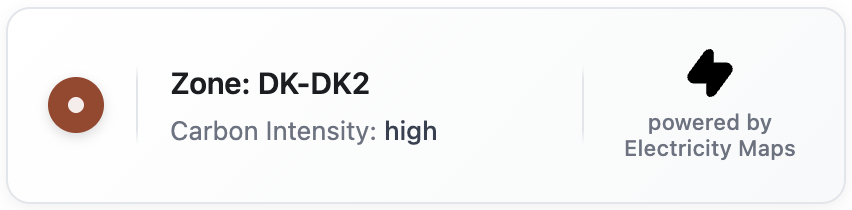

:::callout
**Update, November 2026:** the carbon-aware integration has been discontinued and removed from this website. This post is kept for reference: the badge, the grid-aware behaviour and the console commands described below no longer work here.
:::

During one of Electricity Maps' hack-a-volt, my colleague [Ronan](https://ronan-mch.github.io/) developed a plug-and-play integration to make a website carbon aware.

All you needed was to insert this script into your website's head:

```js
<script src="https://storage.googleapis.com/carbon-aware-websites-javascript/frontend.js"></script>
```

And then you could access the carbon-aware widget:

```js
caw.render({
      target: "carbon-aware-widget",
      callback: (zone, level) => this.handleCarbonLevel(zone, level),
      render: false
});
```

Under the hood, what happened was:

- A Cloudflare Worker queries the Electricity Maps [carbon-intensity-level API](https://portal.electricitymaps.com/developer-hub/api/reference#latest-carbon-intensity-level) with the latitude and longitude of the Cloudflare request. That allows to guess the grid zone in which the user is located.
- A frontend library calls this worker and renders a HTML snippet.

The widget came with a pre-packaged rendered visual (just need to specify `showBadge: true` in the widget call):

:::figure{width="60%"}


Pre-packaged carbon aware badge
:::

For those who wanted to use the widget to control the website dynamically, a callback function could be injected in the render call.

Based on this callback, and some javascript shenanigans, I was able to make this website carbon aware in about an hour. Note that my front-end development days are far gone, so I guess that a web developper could probably do this much more efficiently.

## This blog reacted to changes in the local carbon intensity of electricity

While the integration was live, the following badge was shown in the top-left corner.

:::figure{width="60%"}


Carbon aware badge
:::

There were three levels of carbon intensity, which had the following effects on what was rendered:

- **Low**: The full content of the website was shown.
- **Moderate**: The website was rendered in black and white, with reduced quality images.
- **High**: Images were completely hidden, as well as the disqus comments under the posts. Everything was rendered in black and white.

While it was live, you could test it out directly by opening the browser console and running:

```javascript
// Test high carbon level
window.carbonAwareManager.setCarbonLevel('high');

// Test moderate carbon level
window.carbonAwareManager.setCarbonLevel('moderate');

// Test low carbon level
window.carbonAwareManager.setCarbonLevel('low');
```

With some test images to demonstrate the functionality (this one no longer reacts):

:::figure


Portræt af den svenske maler Ivar Arsenius by Oda Krogh. Credit:
[Wikipedia Commons](https://da.m.wikipedia.org/wiki/Fil:Oda_Krohg_-_Portrait_of_the_Swedish_Painter_Ivar_Arosenius_-_NG.M.00617_-_National_Museum_of_Art,_Architecture_and_Design.jpg).
This image used to disappear when the carbon intensity level was high.
:::

## Why make websites carbon-aware?

To quote Fershad Irani, Tom Jarret and Hannah Smith, in their [Branch post about turning websites grid-aware](https://branch.climateaction.tech/issues/issue-9/designing-a-grid-aware-branch/) (note that here we use carbon-aware and grid-aware interchangeably)

> The idea is to holistically consider the electricity grid that digital thing is operating within, and look for opportunities where it can help, rather than harm, that grid.
